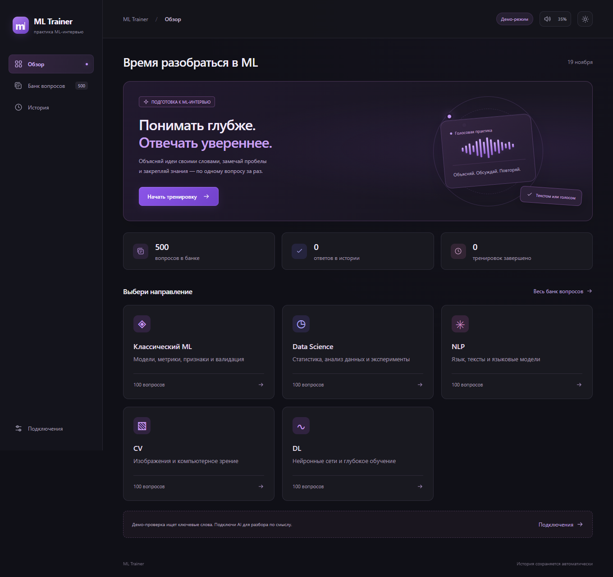
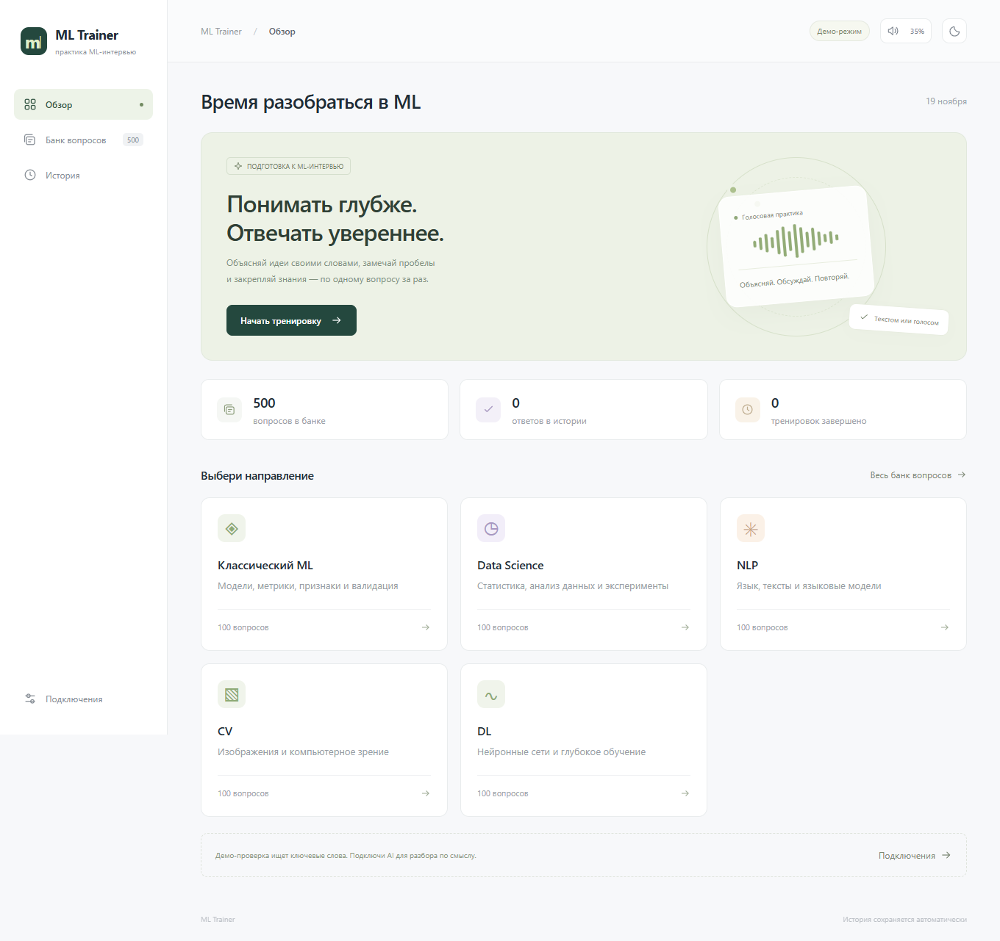

# ML Trainer

Персональный тренажёр для подготовки к собеседованиям по машинному обучению. Отвечай текстом или голосом, получай разбор по критериям и обсуждай замечания с AI-ментором.

**500 вопросов · 5 направлений · Junior / Middle / Senior · Windows desktop**



<details>
<summary>Светлая тема</summary>



</details>

Скриншоты сделаны в демо-режиме на отдельной базе без персональных данных.

## Возможности

- **Практика по темам:** классическое ML, Data Science, NLP, CV и DL. Тренировки на 2–20 вопросов; в смешанном режиме темы чередуются, приоритет получают менее отработанные карточки.
- **Разбор ответа:** модель определяет выполнение критериев и частичный зачёт, приложение вычисляет итоговый балл по весам. После разбора можно задать вопрос или оспорить замечание.
- **Голосовая практика:** запись ответа, распознавание Deepgram с резервом Whisper и редактируемая расшифровка. В режиме голосового диалога приложение само слушает и отправляет ответы после паузы.
- **Озвучка и аватар:** Fish Audio или системный голос, регулировка громкости и интонации, персонаж с реакциями на ход тренировки.
- **Банк и история:** поиск вопросов, фильтры по теме и сложности, сохранение ответов, разборов и обсуждений между запусками. Светлая и тёмная темы.

## Быстрый старт

Нужны **Windows, Python 3.11+** и [WebView2 Runtime](https://developer.microsoft.com/en-us/microsoft-edge/webview2/).

Открой PowerShell в папке, куда хочешь скачать проект:

```powershell
git clone https://github.com/Forzq/ml-trainer.git
cd ml-trainer
.\Setup.cmd
```

Без Git можно скачать ZIP репозитория, распаковать его и открыть `Setup.cmd` двойным щелчком. Скрипт создаст `.venv`, установит зависимости и создаст ярлык. Интернет нужен для установки зависимостей; Docker и Node.js не требуются.

Создай файл настроек, если его ещё нет:

```powershell
if (-not (Test-Path .env)) { Copy-Item .env.example .env }
notepad .env
```

Для AI-проверки заполни два параметра:

```dotenv
OPENROUTER_API_KEY=твой-ключ
OPENROUTER_MODEL=идентификатор-модели-в-OpenRouter
```

Подойдёт доступная в твоём аккаунте текстовая модель с поддержкой JSON-ответов. Затем запусти `Start.vbs` двойным щелчком или выполни:

```powershell
Start-Process .\Start.vbs
```

Откроется отдельное окно **ML Trainer**. Для последующих запусков установка не нужна. Закрой окно, чтобы завершить приложение.

Без API-ключей доступны весь банк, поиск, история и демо-проверка по ключевым словам. Она явно обозначена в интерфейсе и не оценивает понимание. Для голосового ввода добавь `DEEPGRAM_API_KEY` или `OPENAI_API_KEY`; для Fish Audio — `FISH_AUDIO_API_KEY`. Системная озвучка включается через `TTS_PROVIDER=system`. После изменения `.env` перезапусти приложение.

API-сервисы оплачиваются отдельно по тарифам провайдеров. Все параметры описаны в [.env.example](.env.example), подробности запуска и работы — в [руководстве](docs/GUIDE.md).

### Ручная установка и запуск в браузере

Вместо `Setup.cmd` можно установить зависимости вручную. Команды выполняются из корня проекта:

```powershell
python -m venv .venv
.\.venv\Scripts\python.exe -m pip install -r requirements.txt
if (-not (Test-Path .env)) { Copy-Item .env.example .env }
.\.venv\Scripts\python.exe -m app.server
```

Открой **http://127.0.0.1:8765**. Для остановки сервера нажми `Ctrl+C` в терминале. Активация виртуального окружения не требуется: команды используют его Python напрямую. Для desktop-окна после ручной установки запусти `Start.vbs`.

Если команда `python` не найдена, установи Python 3.11+ и добавь его в PATH. Если не открывается desktop-окно, проверь WebView2 Runtime; подробности запуска записываются в `logs/desktop.log` и `logs/server.log`.

## Как устроено

```text
Интерфейс HTML / CSS / JavaScript
            │
      pywebview / WebView2
            │
       локальный FastAPI
            ├── SQLite — тренировки, ответы и обсуждения
            ├── Qdrant — каталог и векторный поиск
            ├── OpenRouter — оценка, диалог и очистка расшифровки
            ├── Deepgram / Whisper — распознавание речи
            └── Fish Audio — озвучка
```

Вопросы, эталоны и критерии хранятся в версионируемом JSON-банке. Оценка выполняется по выбранному вопросу: поиск в Qdrant используется для библиотеки. По умолчанию поиск работает на локальном hashing; для поиска по смыслу можно подключить embeddings через OpenRouter. Docker для локального запуска не требуется.

| Каталог | Содержимое |
|---|---|
| `app/` | FastAPI, хранение, оценщик и интеграции |
| `web/` | Интерфейс без сборки и внешних CDN |
| `content/` | Банк вопросов, критерии и источники |
| `evals/` | Наборы ответов и проверка качества оценщика |
| `tests/`, `scripts/` | Тесты, проверки интерфейса и инструменты разработки |

HTTP-маршруты находятся в `app/server.py`, чтение снимков тренировок и истории обсуждений — в `app/sessions.py`. `app/trainer.py` формирует задания оценщику и диалог, `app/model_client.py` выполняет запросы OpenRouter и безопасно диагностирует ответы. HTML-компоненты вынесены в `web/views.js`; управление интерфейсом остаётся в `web/app.js`.

## Проверка качества

```powershell
.\.venv\Scripts\python.exe -m pip install -r requirements-dev.txt
.\.venv\Scripts\python.exe -m pytest -q
.\.venv\Scripts\python.exe scripts/check-ui.py
.\.venv\Scripts\python.exe scripts/check-rubric-ui.py
.\.venv\Scripts\python.exe scripts/check-live.py
```

Автоматические проверки используют изолированные данные и имитации провайдеров, без платных запросов. Для запуска UI-проверок нужен установленный Microsoft Edge. Дополнительные сценарии для desktop-оболочки и аватара описаны в [руководстве](docs/GUIDE.md#разработка-и-проверка).

Для оценщика подготовлены 88 синтетических ответов с разделением dev/test/regression. В dev-прогоне на 40 ответах получено 38 оценок и два сбоя по лимиту токенов; результаты и замечания сохранены в [аудите](evals/astra-audit-dev-v1.md). Машинная разметка используется как silver; независимая человеческая точность пока не измерена. Методика — в [evals/README.md](evals/README.md).

## Данные и ограничения

История хранится локально в SQLite. API-ключи загружаются сервером из `.env`. При использовании внешних сервисов им передаются соответствующие тексты или голосовая запись; аудио тренировки на диск не сохраняется. `.env`, история, логи и виртуальное окружение исключены из Git.

Приложение предназначено для персонального локального использования и слушает только `127.0.0.1`. Для запуска на другом компьютере нужна установка зависимостей; автономный установщик пока не собран. AI-разбор может ошибаться, а требования отдельных карточек ещё уточняются. Диалог с подсказками до раскрытия эталона и интервальное повторение — следующие направления развития.
